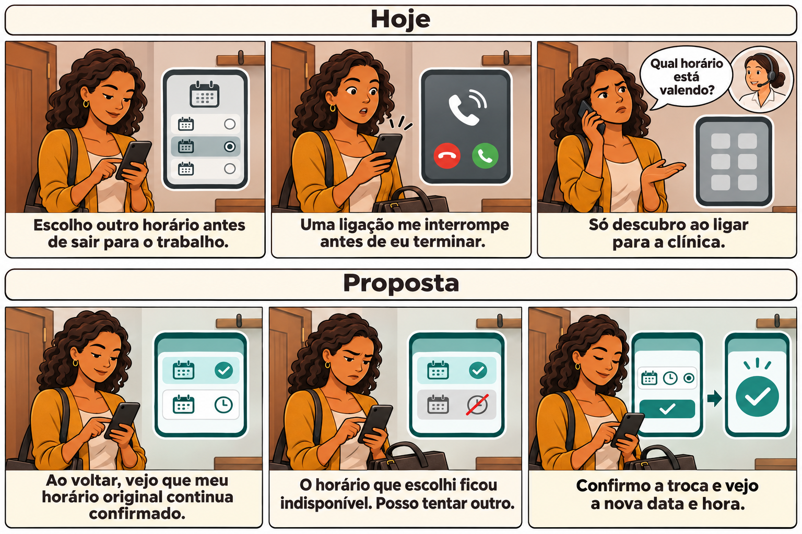

# Cenários Visuais

**Ilustre o fluxo, encontre lacunas e valide a experiência antes do código.**

Cenários Visuais é uma skill para o Codex que ajuda profissionais de produto e engenharia a transformar um relato em uma experiência que o usuário final consegue percorrer e corrigir. Ela é usada na descoberta, quando ainda dá para repensar o fluxo sem investir na implementação.



[Ver o caso completo da remarcação](examples/remarcacao-consulta/README.md).

## Início rápido no Codex


Baixe ou clone este repositório. Copie a pasta [cenarios-visuais](cenarios-visuais/) inteira para `~/.agents/skills/` para uso pessoal ou para `.agents/skills/` no projeto em que deseja usá-la. Mantenha o `SKILL.md` e o guia visual juntos. Se a skill não aparecer no seletor, reinicie o Codex. [Documentação de skills do Codex](https://learn.chatgpt.com/docs/build-skills)

No Codex, digite o nome da skill e descreva o que você quer investigar:

```text
$cenarios-visuais Quero entender por que uma paciente precisou ligar para a clínica depois de tentar remarcar uma consulta pelo celular.
```

## Como funciona


1. Aceita uma frase, um relato longo ou notas de pesquisa. Pergunta uma coisa por vez quando uma informação ausente muda a história.
2. Reconstrói o percurso atual pela perspectiva da pessoa, da necessidade imediata até o desfecho, incluindo o que ela faz fora do produto.
3. Procura passos implícitos, interrupções e outros pontos de falha. Traduz as lacunas em condições de usabilidade que a equipe pode verificar.
4. Apresenta quadros com legendas curtas e compara o antes com a proposta quando os dois são conhecidos. Quando uma decisão muda o percurso, mostra a consequência.
5. Prepara perguntas para a conversa com o usuário. Identifica o que vem de relato, o que é hipótese e o que ainda precisa de validação.

## Exemplos

- [Remarcação de consulta pelo celular](examples/remarcacao-consulta/README.md) — caso fictício testado no Codex, com o relato, a pergunta de descoberta, a comparação visual e as mudanças feitas após o primeiro teste.
- [Acompanhar um pedido sem confirmação](examples/entradas.md) — exemplo de entrada curta que pede investigação antes dos quadros.
- [Retomar o envio de um comprovante](examples/entradas.md#retomar-o-envio-de-um-comprovante) — exemplo de relato mais detalhado e do que ainda precisa ser esclarecido.

## Estrutura do projeto

- [cenarios-visuais/](cenarios-visuais/) — instruções da skill e guia de entrega visual.
- [examples/](examples/) — demonstração ilustrada e exemplos de entrada.
- [docs/](docs/) — proposta inicial e pesquisa de referências.


## Origem da proposta

A ideia nasceu da leitura de *The Product-Minded Engineer*, de Drew Hoskins, do qual vem a estrutura de personagem e simulação. O projeto aplica essa estrutura à descoberta com usuários que precisam reconhecer a própria situação antes de avaliar uma proposta. [Anotações iniciais, pesquisa de referências e proposta da primeira versão](docs/cenarios-de-usuario.md)
