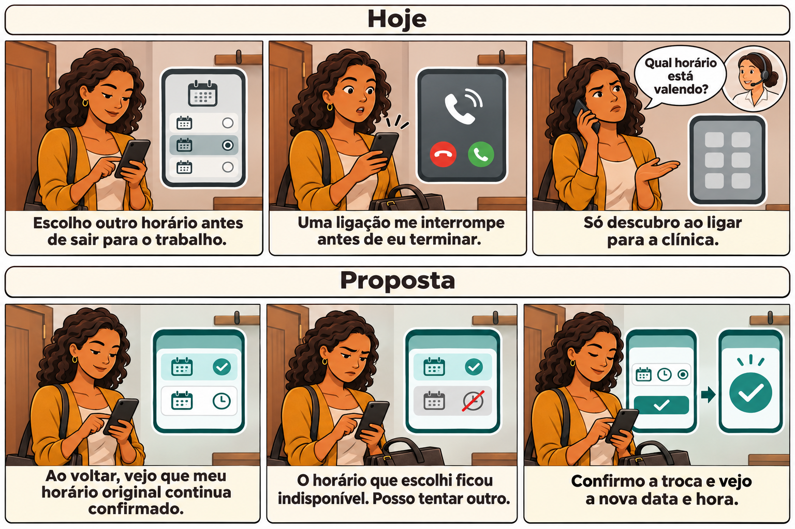

# Remarcação de consulta pelo celular

Exemplo fictício usado para testar a skill no Codex. A entrega visual recebeu feedback durante o teste. A experiência proposta continua pendente de validação com uma paciente.

## Entrada do teste

> Quero melhorar a remarcação de consultas pelo celular. Uma paciente tentou trocar o horário antes de sair para o trabalho. Ela escolheu um novo horário, mas precisou fechar a página quando recebeu uma ligação. Quando voltou, não sabia se a troca tinha acontecido nem em qual horário deveria comparecer. Acabou ligando para a clínica. Quero que ela consiga se ver usando o fluxo e me dizer se a proposta resolveria o problema.

A pergunta que permitiu completar o percurso atual foi **“Quando a paciente reabriu a página, o que ela viu na tela?”**. No caso fictício, ela caiu na página inicial e só soube pelo telefone que o horário original continuava valendo.

## Resultado ilustrado

| Quadro | O que acontece |
| --- | --- |
| 1 · Hoje | A paciente escolhe outro horário antes de sair para o trabalho. |
| 2 · Hoje | Uma ligação a interrompe antes de concluir. |
| 3 · Hoje | Ao voltar à página inicial, ela precisa ligar para descobrir qual horário vale. |
| 4 · Proposta | Ao voltar, ela vê o horário original confirmado e encontra a troca pendente. |
| 5 · Proposta | A opção escolhida ficou indisponível. Ela pode escolher outra com o horário original ainda confirmado. |
| 6 · Proposta | Ela confirma a troca e vê a nova data e hora. |

## O que testar com uma paciente

Mostre primeiro a história atual e peça que a pessoa corrija o que não corresponde à experiência dela. Na proposta, pause no momento em que volta ao celular e pergunte **“Em qual horário você iria à consulta? O que fez você entender isso?”**. Depois mostre que a opção ficou indisponível e pergunte **“O que você faria agora?”**.

A experiência precisa permitir que a pessoa identifique o horário que vale e o próximo passo sem ligar para a clínica. Uma lacuna para investigar é o que acontece se a página fechar logo depois de tocar em confirmar. A paciente precisa descobrir se a troca foi concluída ao voltar.

## O que mudou no primeiro teste

- A pergunta de descoberta tinha encerrado a interação antes do cenário. A skill passou a orientar a retomada assim que chega a resposta, sem exigir uma nova chamada pelo nome.
- A primeira imagem dependia de uma explicação separada. A versão revisada traz uma legenda por quadro e um balão no momento da dúvida. O autor do projeto aprovou a clareza da revisão.
